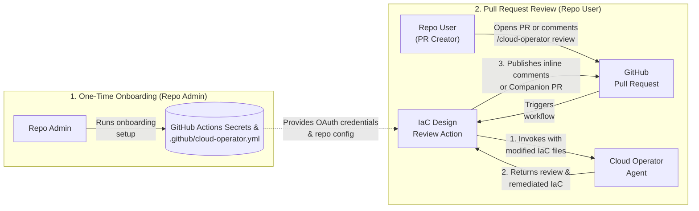

# Cloud Operator — GitHub IaC & Design Review Action

The **Cloud Operator IaC & Design Review Action**
(`integrations/github/actions/iac-review`) automatically reviews Terraform and
Infrastructure-as-Code (IaC) changes in your GitHub Pull Requests against Google
Cloud best practices, security posture, and organization policies.

When a developer opens or updates a Pull Request—or comments
`/cloud-operator review` on a PR—the action sends the modified IaC files to the
**Cloud Operator** agent and delivers actionable feedback directly in GitHub as:

- **Inline Review Comments (`inline_comments`, default)**: Line-anchored review
  comments with one-click GitHub code suggestions on the Pull Request diff.
- **Companion Pull Request (`companion_pr`)**: A dedicated remediation PR
  targeting the contributor's branch with the complete updated files.
- **Summary Comment (`comment_only`)**: A single top-level markdown review
  summary on the Pull Request.

---

## Architecture Overview



1. **Repository Onboarding**: A repository administrator runs the onboarding
   setup once to store Google OAuth credentials in GitHub Actions Secrets
   (`CLOUD_OPERATOR_OAUTH_CONFIG`) and commit the workflow and configuration
   files to the repository.
2. **Pull Request Trigger**: A contributor opens or updates a Pull Request (or
   posts `/cloud-operator review` on an existing PR), triggering the **IaC
   Design Review Action**.
3. **Cloud Operator Invocation**: The action bundles the modified files in the
   Pull Request and invokes the **Cloud Operator** agent against the configured
   Google Cloud project.
4. **Review Response**: The Cloud Operator evaluates the IaC changes and returns
   its findings along with suggested remediations.
5. **Publishing Feedback**: The action parses the response and posts either
   line-anchored inline comments on the PR, a Companion PR with the remediated
   files, or a summary comment based on your repository configuration.

---

## Prerequisites

Before onboarding a repository, the **repository administrator** needs:

1. **GitHub CLI (`gh`)**: Installed and authenticated (`gh auth login`) with
   **Admin** permissions on the target GitHub repository (required to upload
   GitHub Actions secrets, enable workflow PR permissions, and commit the
   workflow configuration).
2. **Google Cloud CLI (`gcloud`)**: Installed and authenticated with Application
   Default Credentials:
   ```bash
   gcloud auth application-default login
   ```
3. **Google Cloud Access**:
   - Access to the target **Google Cloud Project** with Gemini Cloud Assist /
     Cloud Operator enabled.
   - Access to the target **Cloud Operator Agent ID** (or a personal Cloud
     Operator agent in that project).
4. **Python 3.11+**: Installed locally to run the onboarding CLI.

---

## Onboarding a Repository (For Repo Admins)

1. **Authenticate with GitHub and Google Cloud**:

   ```bash
   gh auth login
   gcloud auth application-default login
   ```

2. **Install the onboarding CLI**:

   ```bash
   python3 -m venv /tmp/cloud-operator-venv
   /tmp/cloud-operator-venv/bin/pip install \
     "git+https://github.com/GoogleCloudPlatform/gemini-cloud-assist-mcp.git@main#subdirectory=integrations/github"
   ```

3. **Run the onboarding command**:

   You can run the interactive setup wizard:

   ```bash
   /tmp/cloud-operator-venv/bin/cloud-operator-github-init
   ```

   Or pass your repository and Google Cloud settings directly via flags:

   ```bash
   /tmp/cloud-operator-venv/bin/cloud-operator-github-init \
     --github_repo=<OWNER>/<REPO> \
     --project_id=<YOUR_GCP_PROJECT_ID> \
     --agent_id=<YOUR_OPERATOR_AGENT_ID>
   ```

   This command uploads the `CLOUD_OPERATOR_OAUTH_CONFIG` secret to your GitHub
   repository, enables GitHub Actions Pull Request permissions, and commits
   `.github/cloud-operator.yml` and `.github/workflows/cloud-operator.yml`.

---

## Configuring Triggers and Review Modes

The behavior of the action is controlled by `.github/cloud-operator.yml` in your
repository.

### Sample `.github/cloud-operator.yml`

```yaml
version: 1
# Target Google Cloud project ID used for policy and infrastructure context.
project_id: "my-gcp-project-id"
# Optional Cloud Operator agent ID. Leave empty ("") to use the onboarder's
# personal Cloud Operator agent.
agent_id: "my-operator-agent"

scenarios:
  code_changes:
    enabled: true

    # Events that trigger a review:
    #   - pull_request.opened: Run when a Pull Request is opened
    #   - pull_request.synchronize: Run when new commits are pushed to the PR
    #   - pull_request.reopened: Run when a closed Pull Request is reopened
    #   - issue_comment.created: Run when a user comments trigger_command on the PR
    triggers:
      - pull_request.opened
      - pull_request.synchronize
      - issue_comment.created

    # Slash command that triggers an on-demand review in a PR comment.
    trigger_command: "/cloud-operator review"

    # How review findings are delivered on GitHub:
    #   - inline_comments: Posts line-anchored review comments & code suggestions (Default)
    #   - companion_pr: Opens/updates a Companion PR with remediated files
    #   - comment_only: Posts a single top-level summary comment on the PR
    pr_mode: "inline_comments"

    # GitHub author associations permitted to trigger the action.
    allowed_author_associations:
      - OWNER
      - MEMBER
      - COLLABORATOR

    # Whether Pull Requests from external repository forks can trigger the action.
    allow_fork_prs: false
```

---

## Using the Action (For PR Creators)

Once a repository is onboarded:

1. **Automatic PR Review**: Open a Pull Request modifying Terraform or IaC
   files. If `pull_request.opened` is enabled, the action automatically runs
   and posts its review on your PR.
2. **On-Demand Review & Follow-Up**: Leave a comment on the Pull Request starting
   with `/cloud-operator review` (optionally followed by additional context or
   questions):
   ```text
   /cloud-operator review
   ```
3. **Applying Fixes**:
   - In **`inline_comments`** mode, click **Commit suggestion** (or **Add
     suggestion to batch**) directly on the inline review comments in the
     **Files changed** tab.
   - In **`companion_pr`** mode, review and merge the Companion PR opened by
     GitHub Actions against your feature branch.

---

## Architectural Limitations

- **A1 Agent Identity Binding**: This integration relies on A1 Cloud Operator
  agents, which authenticate and execute using the **User End-User Credentials
  (EUC)** and identity of the **onboarding user** (and their configured agent).
  All Cloud Operator invocations triggered by Pull Requests in the repository
  run under the onboarding user's Google Cloud identity and permissions.
- **ADC Session Expiration & Periodic Credential Refresh**: Because the action
  uses the onboarding user's Application Default Credentials (ADC) stored in the
  `CLOUD_OPERATOR_OAUTH_CONFIG` GitHub secret, those credentials are subject to
  your organization's **Google Cloud session length** policy.
  - When Google Cloud session control is enforced by a Google Workspace or Cloud
    Identity administrator, the **default session length is 16 hours** (and can
    be configured between 1 hour and 24 hours; see
    [Set session length for Google Cloud services](https://support.google.com/a/answer/9368756)).
  - Once the session expires, the refresh token stored in GitHub Secrets can no
    longer mint new access tokens, and the onboarding user must refresh their
    ADC credentials and update the GitHub secret.
  - **Exempting ADC (`Google Cloud SDK`) from Session Expiration**: Organization
    administrators can exempt select applications—such as the **Google Cloud
    SDK** (`gcloud` / ADC)—from the default 16-hour session limit for a specific
    Google Group by applying an Access Context Manager cloud access binding with
    `sessionLengthEnabled: false` (and `sessionLength: 0s`) for
    `Google Cloud SDK`, as documented in
    [Override the default 16-hour session length](https://docs.cloud.google.com/access-context-manager/docs/session-controls-for-reauthentication#override-default-16hr-session).
  - **Automating Credential Sync via Cron**: If your organization enforces finite
    ADC session lengths, you can automate syncing refreshed local ADC
    credentials to GitHub Secrets by scheduling the onboarding CLI as a
    recurring `cron` job:
    ```bash
    # Example cron job (crontab -e) to sync refreshed local ADC credentials to GitHub every 12 hours:
    0 */12 * * * /tmp/cloud-operator-venv/bin/cloud-operator-github-init --github_repo=<OWNER>/<REPO> --project_id=<YOUR_GCP_PROJECT_ID> --agent_id=<YOUR_OPERATOR_AGENT_ID> --interactive=false
    ```
