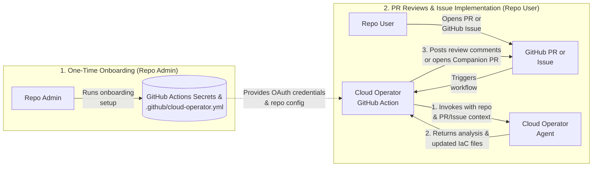

# Cloud Operator — GitHub IaC & Design Review Action

The **Cloud Operator GitHub Action** (`integrations/github/actions/iac-review`)
integrates your GitHub repository with the **Cloud Operator** agent to automate
two Infrastructure-as-Code (IaC) workflows:

1. **Pull Request Design & Security Reviews (`scenarios.code_changes`)**:
   Reviews Terraform and IaC changes in Pull Requests against Google Cloud best
   practices, security posture, and organization policies—delivering feedback as
   **Inline Review Comments** (`inline_comments`, default), a **Companion Pull
   Request** (`companion_pr`), or a **Summary Comment** (`comment_only`).
2. **Issue-Driven Feature Requests & Bug Fixes
   (`scenarios.issue_implementation`)**: Implements new IaC features or fixes
   issues reported in GitHub Issues (on issue creation, label, or
   `/cloud-operator implement` comment), commits the created or modified files
   to a dedicated `cloud-operator/issue-<N>` branch, opens a **Companion Pull
   Request**, and replies on the Issue.

---

## Architecture Overview



1. **Repository Onboarding**: A repository administrator runs the onboarding
   setup once to store Google OAuth credentials in GitHub Actions Secrets
   (`CLOUD_OPERATOR_OAUTH_CONFIG`) and commit the workflow and configuration
   files to the repository.
2. **PR or Issue Trigger**:
   - **Pull Request Review**: A contributor opens or updates a Pull Request (or
     posts `/cloud-operator review` on an existing PR).
   - **Issue Implementation**: A user opens or labels a GitHub Issue describing
     a feature request or bug (or posts `/cloud-operator implement` on an
     existing Issue).
3. **Cloud Operator Invocation**: The action bundles the relevant repository IaC
   files and PR/Issue context and invokes the **Cloud Operator** agent against
   the configured Google Cloud project.
4. **Publishing Results**:
   - For **Pull Requests**, the action posts line-anchored inline comments, a
     Companion PR, or a summary comment based on `pr_mode`.
   - For **Issues**, if files are created or modified, the action pushes
     `cloud-operator/issue-<N>`, opens a Pull Request against `base_branch`
     (`Closes #<N>`), and posts the summary and PR link on the Issue.

---

## Prerequisites

Before onboarding a repository, the **repository administrator** needs:

1. **GitHub CLI (`gh`)**: Installed and authenticated (`gh auth login`) with
   **Admin** permissions on the target GitHub repository (required to upload
   GitHub Actions secrets, enable workflow PR permissions, and commit the
   workflow configuration).
2. **Google Cloud CLI (`gcloud`)**: Installed and authenticated with Application
   Default Credentials:
   ```bash
   gcloud auth application-default login
   ```
3. **Google Cloud Access**:
   - Access to the target **Google Cloud Project** with Gemini Cloud Assist /
     Cloud Operator enabled.
   - Access to the target **Cloud Operator Agent ID** (or a personal Cloud
     Operator agent in that project).
4. **Python 3.11+**: Installed locally to run the onboarding CLI.

---

## Onboarding a Repository (For Repo Admins)

1. **Authenticate with GitHub and Google Cloud**:

   ```bash
   gh auth login
   gcloud auth application-default login
   ```

2. **Install the onboarding CLI**:

   ```bash
   python3 -m venv /tmp/cloud-operator-venv
   /tmp/cloud-operator-venv/bin/pip install \
     "git+https://github.com/GoogleCloudPlatform/gemini-cloud-assist-mcp.git@main#subdirectory=integrations/github"
   ```

3. **Run the onboarding command**:

   You can run the interactive setup wizard:

   ```bash
   /tmp/cloud-operator-venv/bin/cloud-operator-github-init
   ```

   Or pass your repository and Google Cloud settings directly via flags:

   ```bash
   /tmp/cloud-operator-venv/bin/cloud-operator-github-init \
     --github_repo=<OWNER>/<REPO> \
     --project_id=<YOUR_GCP_PROJECT_ID> \
     --agent_id=<YOUR_OPERATOR_AGENT_ID>
   ```

   This command uploads the `CLOUD_OPERATOR_OAUTH_CONFIG` secret to your GitHub
   repository, enables GitHub Actions Pull Request permissions, and commits
   `.github/cloud-operator.yml` and `.github/workflows/cloud-operator.yml`.

---

## Configuring Triggers and Scenarios

Both Pull Request reviews and Issue implementation can be independently enabled,
disabled, and customized in `.github/cloud-operator.yml`.

### Sample `.github/cloud-operator.yml`

```yaml
version: 1
# Target Google Cloud project ID used for policy and infrastructure context.
project_id: "my-gcp-project-id"
# Optional Cloud Operator agent ID. Leave empty ("") to use the onboarder's
# personal Cloud Operator agent.
agent_id: "my-operator-agent"

scenarios:
  # Scenario 1: Pull Request Code & IaC Review
  code_changes:
    enabled: true

    # Events that trigger a PR review:
    #   - pull_request.opened: Run when a Pull Request is opened
    #   - pull_request.synchronize: Run when new commits are pushed to the PR
    #   - pull_request.reopened: Run when a closed Pull Request is reopened
    #   - issue_comment.created: Run when a user comments trigger_command on a PR
    triggers:
      - pull_request.opened
      - pull_request.synchronize
      - issue_comment.created

    # Slash command that triggers an on-demand review in a PR comment.
    trigger_command: "/cloud-operator review"

    # How review findings are delivered on GitHub:
    #   - inline_comments: Posts line-anchored review comments & code suggestions (Default)
    #   - companion_pr: Opens/updates a Companion PR with remediated files
    #   - comment_only: Posts a single top-level summary comment on the PR
    pr_mode: "inline_comments"

    # GitHub author associations permitted to trigger PR reviews.
    allowed_author_associations:
      - OWNER
      - MEMBER
      - COLLABORATOR

    # Whether Pull Requests from external repository forks can trigger the action.
    allow_fork_prs: false

  # Scenario 2: Issue-Driven Feature Requests & Bug Fixes
  issue_implementation:
    enabled: true

    # Events that trigger Issue implementation:
    #   - issues.opened: Run when a new GitHub Issue is created
    #   - issues.labeled: Run when a label is added to an Issue
    #   - issue_comment.created: Run when a user comments trigger_command on an Issue
    triggers:
      - issues.opened
      - issues.labeled
      - issue_comment.created

    # Optional label filter for issues.opened and issues.labeled.
    # Leave empty ([]) to run on all new issues from allowed authors, or specify
    # labels such as ["bug", "enhancement"] to restrict automatic triggers.
    trigger_labels: []

    # Slash command that triggers implementation or iteration in an Issue comment.
    trigger_command: "/cloud-operator implement"

    # Target base branch for Companion PRs created from Issues.
    base_branch: "main"

    # GitHub author associations permitted to trigger Issue implementation.
    allowed_author_associations:
      - OWNER
      - MEMBER
      - COLLABORATOR
```

---

## Using the Action (For Repo Users)

### 1. Reviewing Pull Requests
1. **Automatic PR Review**: Open a Pull Request modifying Terraform or IaC
   files. When `code_changes.enabled` is `true`, the action reviews your changes
   and posts feedback on the PR.
2. **On-Demand Review & Follow-Up**: Leave a comment on the Pull Request starting
   with `/cloud-operator review` (optionally followed by instructions):
   ```text
   /cloud-operator review
   ```
3. **Applying Fixes**: Commit inline code suggestions directly from the **Files
   changed** tab (`inline_comments` mode), or merge the Companion PR opened
   against your branch (`companion_pr` mode).

### 2. Implementing Features & Fixing Bugs from Issues
1. **Open a GitHub Issue**: Create an Issue describing either a **new IaC
   feature** you want provisioned or a **bug/policy violation** you want fixed,
   including as much detail as needed. When `issue_implementation.enabled` is
   `true` (and any configured `trigger_labels` match), the action runs
   automatically.
2. **On-Demand Implementation & Iteration**: Comment on any Issue starting with
   `/cloud-operator implement` to trigger implementation or request follow-up
   adjustments on an open Companion PR:
   ```text
   /cloud-operator implement please place the Cloud Run service in us-central1
   ```
3. **Reviewing the Generated Pull Request**: When the Cloud Operator adds or
   modifies repository files, the action opens (or updates) a Pull Request from
   `cloud-operator/issue-<N>` targeting `base_branch` and posts a link on your
   Issue.

---

## Architectural Limitations

- **A1 Agent Identity Binding**: This integration relies on A1 Cloud Operator
  agents, which authenticate and execute using the **User End-User Credentials
  (EUC)** and identity of the **onboarding user** (and their configured agent).
  All Cloud Operator invocations triggered by Pull Requests or Issues in the
  repository run under the onboarding user's Google Cloud identity and
  permissions.
- **ADC Session Expiration & Periodic Credential Refresh**: Because the action
  uses the onboarding user's Application Default Credentials (ADC) stored in the
  `CLOUD_OPERATOR_OAUTH_CONFIG` GitHub secret, those credentials are subject to
  your organization's **Google Cloud session length** policy.
  - When Google Cloud session control is enforced by a Google Workspace or Cloud
    Identity administrator, the **default session length is 16 hours** (and can
    be configured between 1 hour and 24 hours; see
    [Set session length for Google Cloud services](https://support.google.com/a/answer/9368756)).
  - Once the session expires, the refresh token stored in GitHub Secrets can no
    longer mint new access tokens, and the onboarding user must refresh their
    ADC credentials and update the GitHub secret.
  - **Exempting ADC (`Google Cloud SDK`) from Session Expiration**: Organization
    administrators can exempt select applications—such as the **Google Cloud
    SDK** (`gcloud` / ADC)—from the default 16-hour session limit for a specific
    Google Group by applying an Access Context Manager cloud access binding with
    `sessionLengthEnabled: false` (and `sessionLength: 0s`) for
    `Google Cloud SDK`, as documented in
    [Override the default 16-hour session length](https://docs.cloud.google.com/access-context-manager/docs/session-controls-for-reauthentication#override-default-16hr-session).
  - **Automating Credential Sync via Cron**: If your organization enforces finite
    ADC session lengths, you can automate syncing refreshed local ADC
    credentials to GitHub Secrets by scheduling the onboarding CLI as a
    recurring `cron` job:
    ```bash
    # Example cron job (crontab -e) to sync refreshed local ADC credentials to GitHub every 12 hours:
    0 */12 * * * /tmp/cloud-operator-venv/bin/cloud-operator-github-init --github_repo=<OWNER>/<REPO> --project_id=<YOUR_GCP_PROJECT_ID> --agent_id=<YOUR_OPERATOR_AGENT_ID> --interactive=false
    ```
